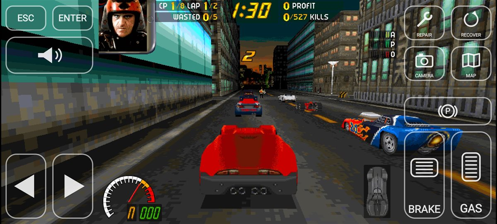
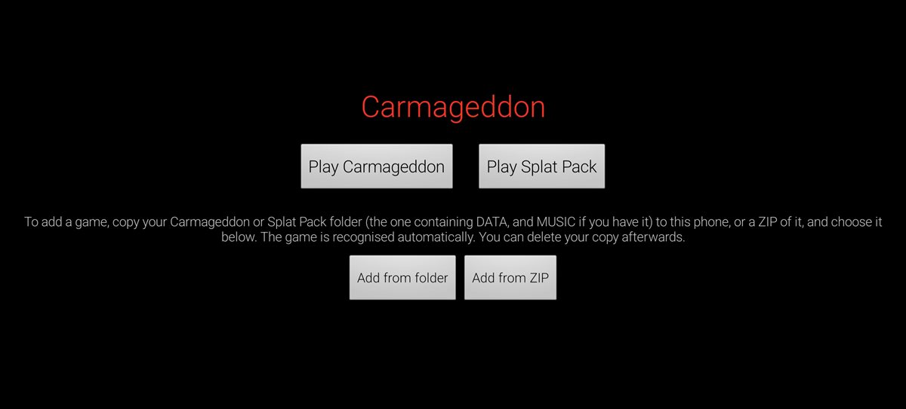

# Carmageddon for Android (dethrace)

An Android build of [dethrace](https://github.com/dethrace-labs/dethrace), the
reverse-engineered Carmageddon engine, with on-screen touch controls and a
widescreen race view. The Android work lives on the `android` branch; `main`
is upstream dethrace.

**No game files are included.** You need your own copy of Carmageddon (original
CD, GOG or Steam).



*A race on a 20:9 phone



*The start screen: play either game, or add game files from a folder or ZIP.*

## What you get

- The original game in 640x480 ("hires") mode
- Widescreen races: the 3D view fills the phone's width and shows more of the
  world at the sides. Menus, cockpit view, the map and the HUD stay 4:3 in the
  middle.
- Touch controls placed beside the HUD (see [Controls](#controls))
- CD music, if your game folder has it as OGG files (see [Game files](#1-get-the-game-files))
- Needs Android 7.0 or newer on a 64-bit (arm64) phone

## Quick install (ready-made APK)

1. Download the APK from the latest release on the
   [Releases page](https://github.com/crumperxtc/dethrace-android/releases)
   on your phone, tap it, and allow **install unknown apps** if asked. If Play
   Protect warns about an unknown app, tap **More details > Install anyway**.
2. Copy your Carmageddon folder (the one containing `DATA`, see
   [Game files](#1-get-the-game-files)) to the phone, for example into
   `Download`. A ZIP of the folder works too and is easier to copy as one file.
3. Open the app, tap **Add from folder** (or **Add from ZIP**) and pick what
   you copied. The app recognises whether it's Carmageddon or the Splat Pack
   and copies `DATA` and `MUSIC` into its own storage, which takes a minute.
   You can delete your copy afterwards.
4. Tap **Play Carmageddon** (or **Play Splat Pack**).

Have the Splat Pack too? Add it the same way. It's an expansion, so it needs
Carmageddon added as well. Each game keeps its own saves, and the start screen
has a Play button for each.

The ready-made APK contains no game files, so it's fine to share. That's all;
the rest of this page is for building it yourself.

## Building it yourself

### 1. Get the game files

You need a Carmageddon folder that contains `DATA`, plus optional `MUSIC`:

```
carmageddon/
  DATA/          <- required (has GENERAL.TXT, RACES, CARS, ...)
  MUSIC/         <- optional: Track02.ogg ... Track08.ogg
```

- **GOG:** use the installed game folder as it is. GOG's version already has
  `MUSIC` in this format. Other digital versions should work the same way if
  they have a `DATA` folder.
- **Original CD:** copy the `DATA` folder from the CD. The music is stored as CD
  audio tracks, so rip tracks 2-8 to OGG and name them `Track02.ogg`,
  `Track03.ogg` and so on, in a `MUSIC` folder. If you skip this, the game just
  has no music.
- **Splat Pack:** same layout. Add it from the app's start screen; it's
  recognised by its races (`DATA/RACES/CASTLE.TXT`) and kept separately from
  the base game. It's an expansion, so **add the base game too**: the first
  time you play the Splat Pack, the app copies in the base game files it
  doesn't replace, like the PC installer did. Builds with packed-in data only
  pack the base game.

### 2. Install the build tools (Windows)

1. **JDK 17 or newer**, for example [Eclipse Temurin](https://adoptium.net/).
   Set `JAVA_HOME` to its folder.
2. **Android SDK command-line tools.** Download "Command line tools only" from
   [developer.android.com/studio](https://developer.android.com/studio), unzip
   it to `%LOCALAPPDATA%\Android\Sdk\cmdline-tools\latest`, then run:

   ```
   cd %LOCALAPPDATA%\Android\Sdk\cmdline-tools\latest\bin
   sdkmanager --licenses
   sdkmanager "platform-tools" "platforms;android-35" "build-tools;35.0.1" "cmake;3.31.6" "ndk;29.0.14206865"
   ```

3. **Git**, from [git-scm.com](https://git-scm.com/)

### 3. Get the source

The build expects SDL2 to be checked out **next to** this repository:

```
git clone -b android https://github.com/crumperxtc/dethrace-android.git dethrace
cd dethrace
git submodule update --init
cd ..
git clone --depth 1 -b release-2.32.10 https://github.com/libsdl-org/SDL.git SDL2
```

That gives you:

```
some-folder/
  dethrace/    <- this repository
  SDL2/
```

If SDL2 is somewhere else, add `-Psdl2Dir=C:\path\to\SDL2` to the build command.

### 4. Build the APK

Create `android\local.properties` with the location of your SDK (use forward
slashes):

```
sdk.dir=C:/Users/YOU/AppData/Local/Android/Sdk
```

Then build. There are two kinds of APK:

- **Without game data** (about 5 MB, shareable). The app asks for the game
  folder on first launch, as in [Quick install](#quick-install-ready-made-apk):

  ```
  cd dethrace\android
  gradlew.bat assembleDebug -PgameDir=
  ```

- **With your game data packed in** (about 320 MB, for your own phone only;
  **don't share it**, it contains copyrighted game files). Point `gameDir` at
  your Carmageddon folder from step 1:

  ```
  cd dethrace\android
  gradlew.bat assembleDebug -PgameDir=C:\Games\Carmageddon
  ```

The first build downloads Gradle and takes a few minutes. The APK ends up in
`android\app\build\outputs\apk\debug\app-debug.apk`. When switching between
the two kinds, delete that file first: Gradle updates it in place and otherwise
keeps the old file size.

### 5. Install it on your phone

1. Copy `app-debug.apk` to your phone (USB cable, cloud drive, etc.) and tap it
   in a file manager.
2. If Android asks, allow that app to **install unknown apps**.
3. If Play Protect warns about an unknown app, tap **More details > Install
   anyway**. It's signed with a debug key because it's a personal build.

To update, install a newer APK over the old one. Saves and settings are kept.

### 6. First launch

The app opens on the start screen. With the data packed in, **Play
Carmageddon** is ready straight away; the first time you press it, the screen
stays **black for 10-30 seconds** while the game data is unpacked to the
phone's storage. Don't close the app during this. Allow about 650 MB of free
space (the APK plus the unpacked copy). Without packed data, add the game files
as in [Quick install](#quick-install-ready-made-apk).

Each game's files and save games live in
`Android/data/org.dethrace.carmageddon/files/carmageddon/` and
`.../files/splatpack/`. If you leave the app while playing, tapping its icon
takes you back into the game.

## Controls

| Where | Control | Does |
|---|---|---|
| Left, bottom | ◀ ▶ | Steer. Slide your thumb between them without lifting. |
| Right, bottom | Pedals | Brake/reverse (wide pedal) and gas (tall pedal) |
| Right | (P) | Handbrake |
| Right, top | Wrench / circular arrow | Repair / recover the car |
| Right, top | Camera / map | Change camera view / show the map |
| Left | Horn | Horn |
| Left, top | ESC / ENTER | Pause menu, back / confirm |
| Empty screen | Drag | Swing the camera around the car (left/right) and zoom (up/down) |
| Empty screen | Double tap | Put the camera back behind the car |
| Phone back button | | Escape |

In menus, steering and the pedals move the selection, ENTER confirms, and you
can also tap menu items directly.

The buttons press Carmageddon's **default** keys (numpad 4/6/8/2 for driving,
Space, Backspace, Insert, C, Tab, H). If you change the key bindings in the
game's options, the on-screen buttons stop matching.

## Troubleshooting

- **Start screen says it can't find DATA/GENERAL.TXT**: pick the folder that
  contains `DATA` (or `DATA` itself, or a ZIP with `DATA` inside). Picking the
  folder above it also works.
- **"Game data not found"** when the game starts: the imported files are
  incomplete. Add the game again from the start screen; your saves are kept.
- **To switch games**, quit the one you're playing from its main menu, then
  open the app again and pick the other one.
- **"Couldn't unpack the game data"**: free up space on the phone and start
  the app again.
- **Build fails with "No Carmageddon DATA folder"**: `-PgameDir` must point at
  the folder that *contains* `DATA`, not at `DATA` itself.
- **Black bars in races**: widescreen only applies to the chase camera. The
  cockpit view and the map are always 4:3.

## How it's put together

- `app/jni/android_main.c`: Android entry point. Unpacks the bundled game data
  and starts dethrace with `-hires --widescreen=<width>`.
- `app/src/main/java/org/dethrace/carmageddon/`: `SetupActivity` (launcher;
  imports game files when the APK has none) and the touch overlay
  (`CarmageddonActivity`, `TouchButton`, `SteeringPad`, `LookArea`, `Icons`).
- Engine changes are marked as dethrace additions in `src/DETHRACE` and
  `src/harness`: widescreen rendering (`graphics.c`, `allsys.c`, `sdl2.c`) and
  touch camera control (`controls.c`).
